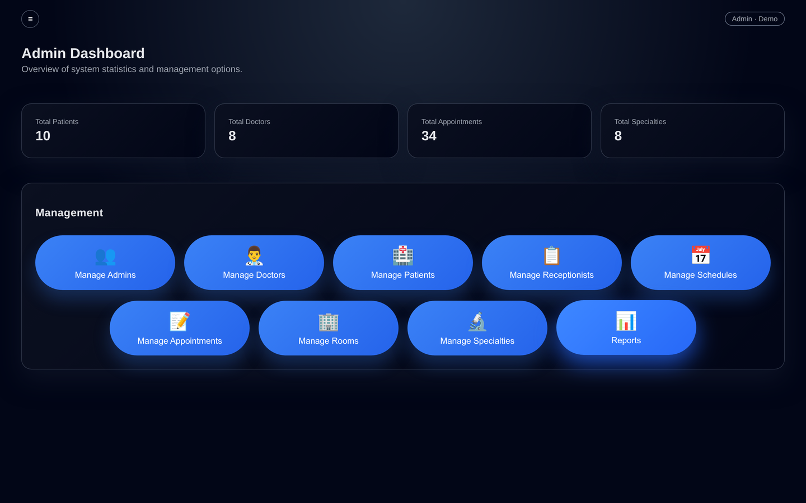
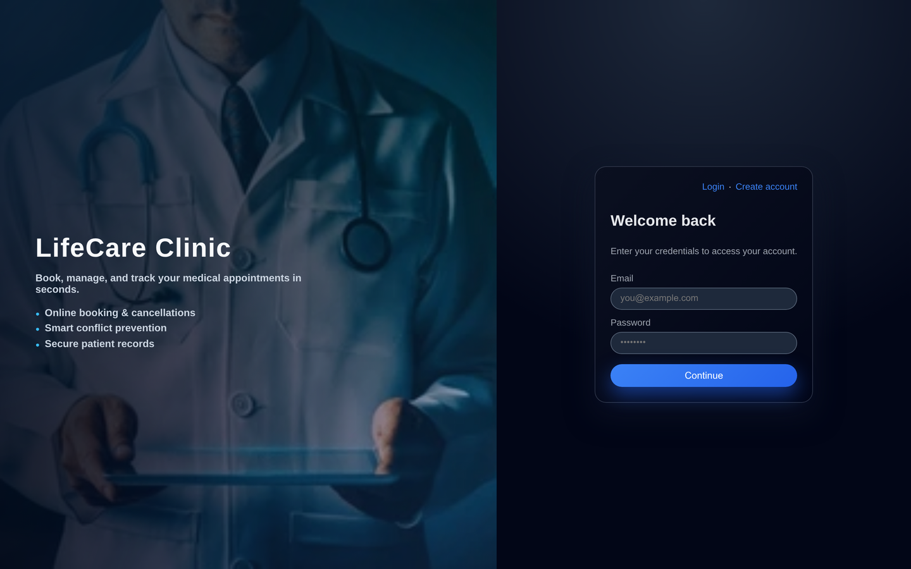
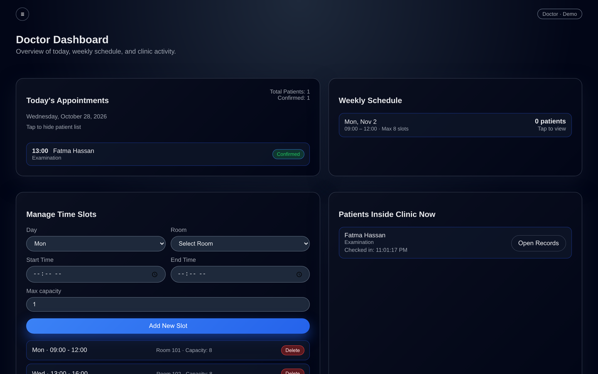
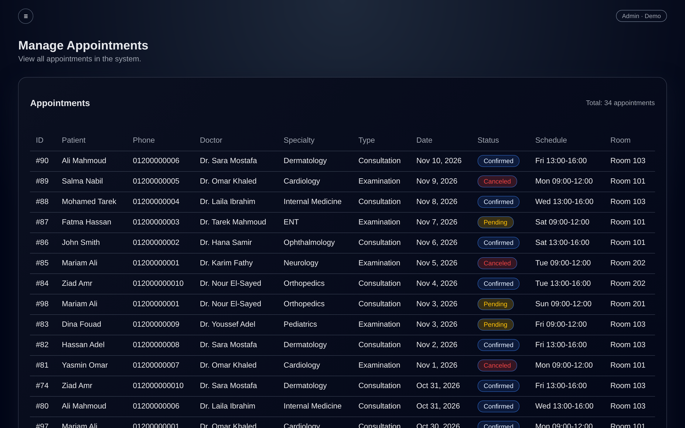
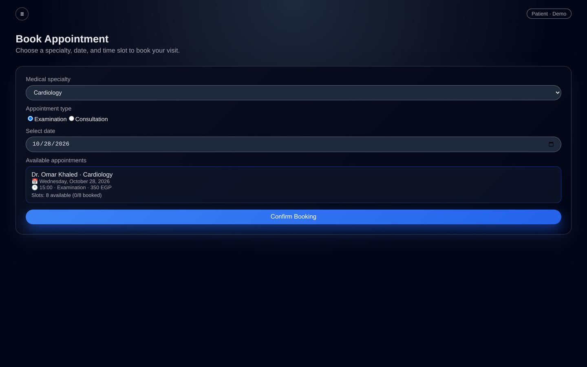
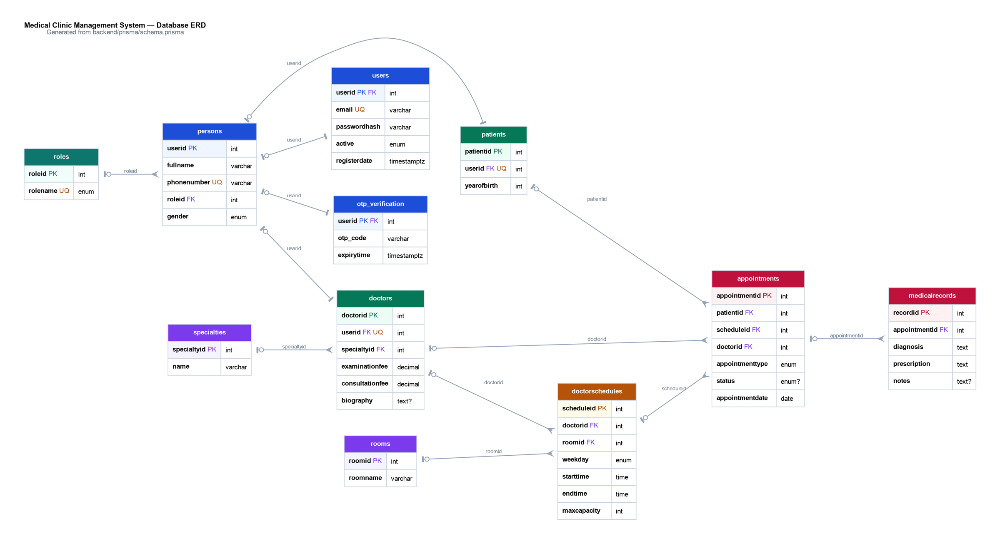

# Medical Clinic Management System

A full-stack clinic management platform for booking, tracking and administering
medical appointments. It ships with four role-based workspaces — **Admin**,
**Doctor**, **Receptionist** and **Patient** — backed by an Express + Prisma API
and a React single-page application.



## Overview

The system covers the day-to-day flow of a small clinic: patients browse
specialties and available slots, book or cancel appointments, and review their
medical history; doctors see today's queue and their weekly schedule and write
medical records; receptionists book on behalf of patients; and admins manage
doctors, patients, receptionists, rooms, specialties, schedules and reports from
one dashboard.

Authentication is JWT-based, passwords are hashed with bcrypt, and new patient
accounts are verified by a six-digit OTP sent over email. Appointment booking is
capacity-aware and doctor schedules cannot overlap on the same weekday.

## Features

### Admin
- Dashboard with live totals for patients, doctors, appointments and specialties
- Full CRUD for doctors, patients, receptionists, rooms and specialties
- Weekly doctor schedules with room assignment and capacity limits
- Appointment overview with status, doctor, schedule and room
- Reports: appointments per weekday for a custom date range

### Doctor
- Today's appointments with patient and visit type
- Weekly schedule and appointment plan
- Medical record editor (diagnosis, prescription, notes)
- Access to the patient's medical history

### Patient
- Register with email OTP verification
- Book an appointment by specialty, date and available slot
- Cancel upcoming appointments
- Upcoming/past appointments and medical history

### Receptionist
- Book appointments for walk-in or phone patients
- View and manage the clinic's daily appointments

## Tech stack

| Layer | Technology |
| --- | --- |
| Frontend | React 18, React Router 6, Vite 6, Axios |
| Backend | Node.js, Express 5, JWT, bcrypt, Nodemailer |
| Database | PostgreSQL, Prisma ORM 6 |
| Reporting | Custom aggregation endpoints |
| Tooling | Prisma Migrate, Graphviz (ERD) |

## Screenshots

| Login | Doctor dashboard |
| --- | --- |
|  |  |

| Manage appointments | Book appointment |
| --- | --- |
|  |  |

The full gallery — admin CRUD screens, reports, schedules, patient view and the
database ERD — lives in [`docs/README.md`](docs/README.md). A ready-to-upload
thumbnail is available at [`docs/screenshots/thumbnail.jpg`](docs/screenshots/thumbnail.jpg).

## Database design

The schema contains 11 models: `persons`, `users`, `roles`, `otp_verification`,
`doctors`, `patients`, `specialties`, `rooms`, `doctorschedules`,
`appointments` and `medicalrecords`.



The source diagram is [`docs/erd.dot`](docs/erd.dot); regenerate the PNG with:

```bash
dot -Tpng -Gdpi=150 docs/erd.dot -o docs/screenshots/11-erd.png
```

## Project structure

```
medical-clinic-management-system/
├── backend/
│   ├── prisma/
│   │   ├── schema.prisma        # Data model
│   │   ├── migrations/          # Versioned SQL migrations
│   │   └── seed.js              # Demo data
│   └── src/
│       ├── config/              # Constants, Prisma client, email
│       ├── controllers/         # HTTP layer
│       ├── services/            # Business logic and queries
│       ├── routes/              # Express routers
│       ├── middlewares/         # Auth and error handling
│       └── app.js               # Express app (also exported for serverless)
├── frontend/
│   └── src/
│       ├── api/                 # Axios clients per role
│       ├── components/          # Reusable UI (tables, modals, cards)
│       ├── layouts/             # Auth and dashboard shells
│       ├── pages/               # Route-level screens
│       └── styles.css           # Design system
└── docs/                        # API reference, screenshots, ERD, guide
```

## Getting started

### Prerequisites

- Node.js 18+
- PostgreSQL 14+

### 1. Backend

```bash
cd backend
npm install
cp .env.example .env          # set DATABASE_URL and JWT_SECRET
npx prisma migrate deploy     # or: npx prisma migrate dev
npm run seed                  # optional demo data
npm start
```

The API runs on `http://localhost:3000`. Health check: `GET /test`.

### 2. Frontend

```bash
cd frontend
npm install
cp .env.example .env          # optional; defaults to the local API
npm run dev
```

The app runs on `http://localhost:5175`.

### Demo accounts

The seed script creates one account per role plus eight doctors and ten patients:

| Role | Email | Password |
| --- | --- | --- |
| Admin | `admin@clinic.com` | `Admin@123` |
| Doctor | `doctor@clinic.com` | `Doctor@123` |
| Patient | `patient@clinic.com` | `Patient@123` |
| Receptionist | `reception@clinic.com` | `Reception@123` |

## API

Base URL: `http://localhost:3000/api`

- `POST /auth/register`, `POST /auth/verify-otp`, `POST /auth/login`
- `/admin/*` — dashboard stats, CRUD, schedules, appointments, reports
- `/doctor/*` — today's appointments, weekly plan, records
- `/patient/*` — specialties, availability, booking, history
- `/reception/*` — booking and appointment management

See [`docs/API.md`](docs/API.md) for the full endpoint reference.

## Deployment (Vercel)

The repository is prepared for a single Vercel project:

- `vercel.json` builds `frontend/` as a static site and routes `/api/*` to the
  Express app through `api/index.js`.
- Prisma Client is generated at build time; run migrations once against the
  hosted database. Set `DATABASE_URL` and `JWT_SECRET` in the Vercel project
  environment.

```bash
npx vercel --prod
```

Use a hosted PostgreSQL instance (Neon, Supabase or Vercel Postgres) and run
`npx prisma migrate deploy` once against it. Email OTP verification additionally
needs `EMAIL_USER` and `EMAIL_PASSWORD` (Gmail app password); login and the demo
screens work without it.

## Documentation

- [API reference](docs/API.md)
- [Screenshots and ERD](docs/README.md)
- [Team collaboration guide](docs/team-collaboration-guide.pdf)

## License

ISC
