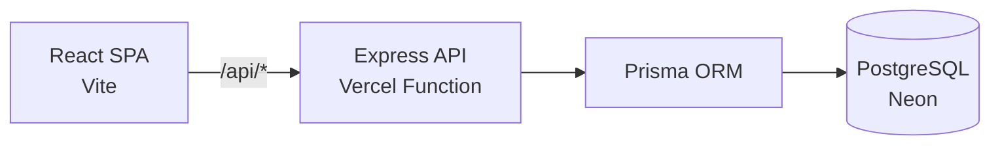

# Medical Clinic Management System

**A full-stack clinic operations platform for booking, managing and tracking medical appointments.**

[](https://medical-clinic-management-system-livid.vercel.app)
[](https://react.dev)
[](https://expressjs.com)
[](https://www.prisma.io)
[](https://www.postgresql.org)
[](https://vercel.com)


## Overview

The system covers the day-to-day flow of a small clinic. Patients browse
specialties and available slots, book or cancel appointments, and review their
medical history. Doctors see today's queue and their weekly schedule and write
medical records. Receptionists book on behalf of patients, and admins manage
doctors, patients, receptionists, rooms, specialties, schedules and reports from
a single dashboard.

Authentication is JWT-based, passwords are hashed with bcrypt, and new patient
accounts are verified by a six-digit OTP sent over email. Appointment booking is
capacity-aware, and a doctor cannot have overlapping schedules on the same
weekday.

The live demo is seeded with **16 doctors, 60 patients, 38 weekly schedules and
over 500 appointments**. The login page includes click-to-fill demo accounts for
each role.

## Table of contents

- [Features](#features)
- [Tech stack](#tech-stack)
- [Architecture](#architecture)
- [Screenshots](#screenshots)
- [Database design](#database-design)
- [Getting started](#getting-started)
- [Demo accounts](#demo-accounts)
- [API](#api)
- [Deployment](#deployment)
- [Project structure](#project-structure)
- [License](#license)

## Features

### Admin
- Live dashboard totals for patients, doctors, appointments and specialties
- Full CRUD for doctors, patients, receptionists, rooms and specialties
- Weekly doctor schedules with room assignment and capacity limits
- Appointment overview with status, doctor, schedule and room
- Reports: appointments per weekday for a custom date range

### Doctor
- Today's appointments with patient and visit type
- Weekly schedule and appointment plan
- Medical record editor (diagnosis, prescription, notes)
- Access to the patient's medical history

### Patient
- Register with email OTP verification
- Book an appointment by specialty, date and available slot
- Cancel upcoming appointments
- Upcoming/past appointments and medical history

### Receptionist
- Book appointments for walk-in or phone patients
- View and manage the clinic's daily appointments

## Tech stack

| Layer | Technology |
| --- | --- |
| Frontend | React 18, React Router 6, Vite 6, Axios |
| Backend | Node.js, Express 5, JWT, bcrypt, Nodemailer |
| Database | PostgreSQL, Prisma ORM 6 |
| Reporting | Custom aggregation endpoints |
| Tooling | Prisma Migrate, Graphviz (ERD), Playwright (screenshots) |
| Hosting | Vercel Services (static frontend + Express function), Neon Postgres |

## Architecture



The frontend and backend deploy together as one Vercel project using
[Vercel Services](https://vercel.com/docs/services): `frontend/` is served as a
static Vite app, while `backend/` runs as a serverless Express service. Both
services share the same domain, so the browser calls `/api/*` with no CORS or
hard-coded host.

## Screenshots

| Login — click-to-fill demo accounts | Doctor dashboard |
| --- | --- |
|  |  |

| Manage appointments | Book appointment |
| --- | --- |
|  |  |

The full gallery — admin CRUD screens, schedules, patients, reports and the
database ERD — lives in [`docs/README.md`](docs/README.md). A ready-to-upload
thumbnail is available at
[`docs/screenshots/thumbnail.jpg`](docs/screenshots/thumbnail.jpg).

## Database design

The schema contains 11 models: `persons`, `users`, `roles`, `otp_verification`,
`doctors`, `patients`, `specialties`, `rooms`, `doctorschedules`,
`appointments` and `medicalrecords`.


The source diagram is [`docs/erd.dot`](docs/erd.dot); regenerate the PNG with:

```bash
dot -Tpng -Gdpi=150 docs/erd.dot -o docs/screenshots/11-erd.png
```

## Getting started

### Prerequisites

- Node.js 18+
- PostgreSQL 14+

### 1. Backend

```bash
cd backend
npm install
cp .env.example .env          # set DATABASE_URL and JWT_SECRET
npx prisma migrate deploy     # or: npx prisma migrate dev
npm run seed                  # optional demo data
npm start
```

The API runs on `http://localhost:3000`. Health check: `GET /test`.

### 2. Frontend

```bash
cd frontend
npm install
cp .env.example .env          # optional; defaults to the local API
npm run dev
```

The app runs on `http://localhost:5175`.

### Environment variables

| Variable | Required | Description |
| --- | --- | --- |
| `DATABASE_URL` | Yes | PostgreSQL connection string |
| `JWT_SECRET` | Yes | Signing secret for access tokens |
| `EMAIL_USER` | No | Gmail address for OTP emails |
| `EMAIL_PASSWORD` | No | Gmail app password for OTP emails |
| `VITE_API_BASE_URL` | No | API base URL (defaults to `/api` in production) |

## Demo accounts

The seed script creates one account per role. On the login page, click any row
in **Demo accounts** to fill the form automatically.

| Role | Email | Password |
| --- | --- | --- |
| Admin | `admin@clinic.com` | `Admin@123` |
| Doctor | `doctor@clinic.com` | `Doctor@123` |
| Patient | `patient@clinic.com` | `Patient@123` |
| Receptionist | `reception@clinic.com` | `Reception@123` |

## API

Base URL: `http://localhost:3000/api`

- `POST /auth/register`, `POST /auth/verify-otp`, `POST /auth/login`
- `/admin/*` — dashboard stats, CRUD, schedules, appointments, reports
- `/doctor/*` — today's appointments, weekly plan, records
- `/patient/*` — specialties, availability, booking, history
- `/reception/*` — booking and appointment management

See [`docs/API.md`](docs/API.md) for the full endpoint reference.

## Deployment

The repository is configured for **Vercel Services**:

- `frontend/` — static Vite build, exposed at `/`
- `backend/` — Express app, exposed at `/api/*` through `backend/index.js`
- `vercel.json` defines both services and the public rewrites.

```bash
npx vercel --prod
```

Set `DATABASE_URL` and `JWT_SECRET` in the Vercel project. Use a hosted
PostgreSQL instance (Neon, Supabase or Vercel Postgres) and run
`npx prisma migrate deploy` once against it. Email OTP verification additionally
needs `EMAIL_USER` and `EMAIL_PASSWORD`; login and the demo screens work without
them.

## Project structure

```
medical-clinic-management-system/
├── backend/
│   ├── index.js                 # Serverless service entry point
│   ├── prisma/
│   │   ├── schema.prisma        # Data model
│   │   ├── migrations/          # Versioned SQL migrations
│   │   └── seed.js              # Demo data
│   └── src/
│       ├── config/              # Constants, Prisma client, email
│       ├── controllers/         # HTTP layer
│       ├── services/            # Business logic and queries
│       ├── routes/              # Express routers
│       ├── middlewares/         # Auth and error handling
│       └── app.js               # Express app
├── frontend/
│   └── src/
│       ├── api/                 # Axios clients per role
│       ├── components/          # Reusable UI (tables, modals, cards)
│       ├── layouts/             # Auth and dashboard shells
│       ├── pages/               # Route-level screens
│       └── styles.css           # Design system
├── docs/                        # API reference, screenshots, ERD, guide
└── vercel.json                  # Frontend + backend services
```

## License

ISC
