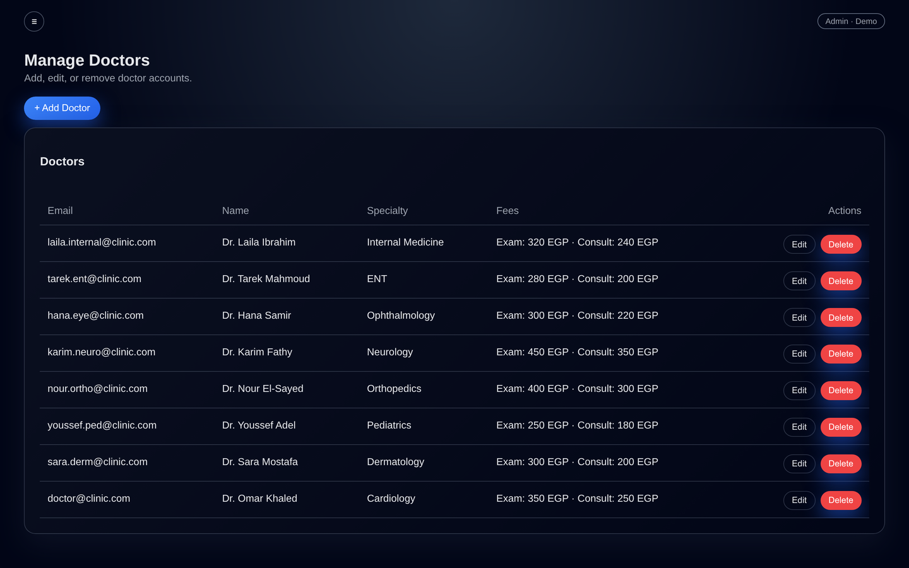
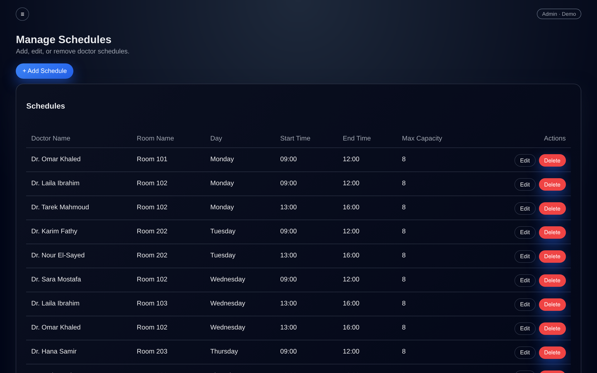
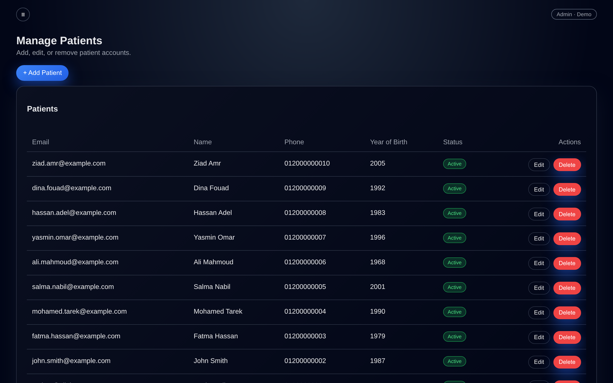
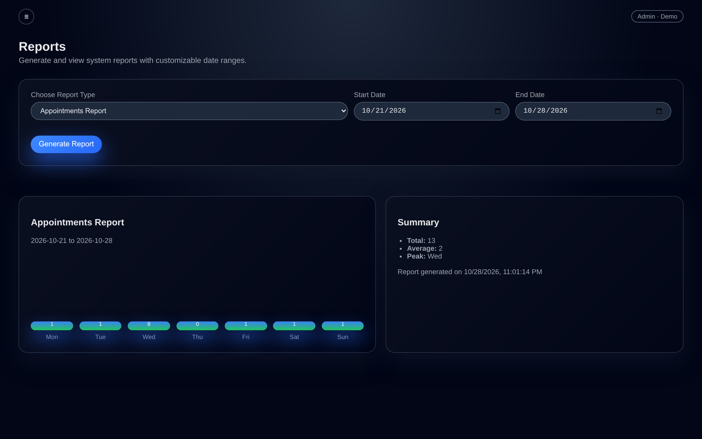
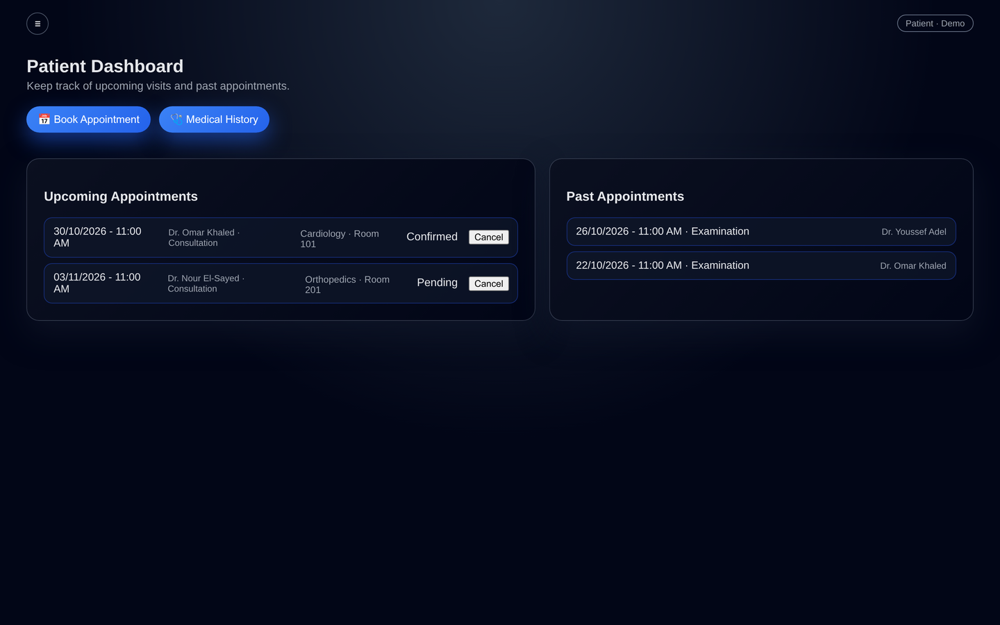

# Screenshots & Database Design

Portfolio-ready screenshots of the Medical Clinic Management System, captured
from the seeded demo environment (1440×900, dark theme).

## Application screens

| | |
| --- | --- |
|  **Login** — public entry page |  **Admin dashboard** — live stats and shortcuts |
|  **Manage doctors** — specialties and fees |  **Manage appointments** — status, schedule and room |
|  **Manage schedules** — weekly slots and rooms |  **Manage patients** — accounts and visit counts |
|  **Reports** — appointments per weekday |  **Doctor dashboard** — today's queue and weekly plan |
|  **Patient dashboard** — upcoming and past visits |  **Book appointment** — specialty, date and available slots |

## Database ERD

Generated from [`backend/prisma/schema.prisma`](../backend/prisma/schema.prisma)
with Graphviz (source: [`erd.dot`](erd.dot)).


## Files for a portfolio / freelance listing

- `screenshots/thumbnail.png` — public login page (1440×900)
- `screenshots/thumbnail.jpg` — same image, 1200×750, ready to upload
- `screenshots/*.png` — all screens in display order
- `screenshots/11-erd.png` — database diagram

Re-capture the screens after UI changes with:

```bash
npm i -D playwright && npx playwright install chromium
node docs/capture.js   # requires the backend + frontend running locally
```
